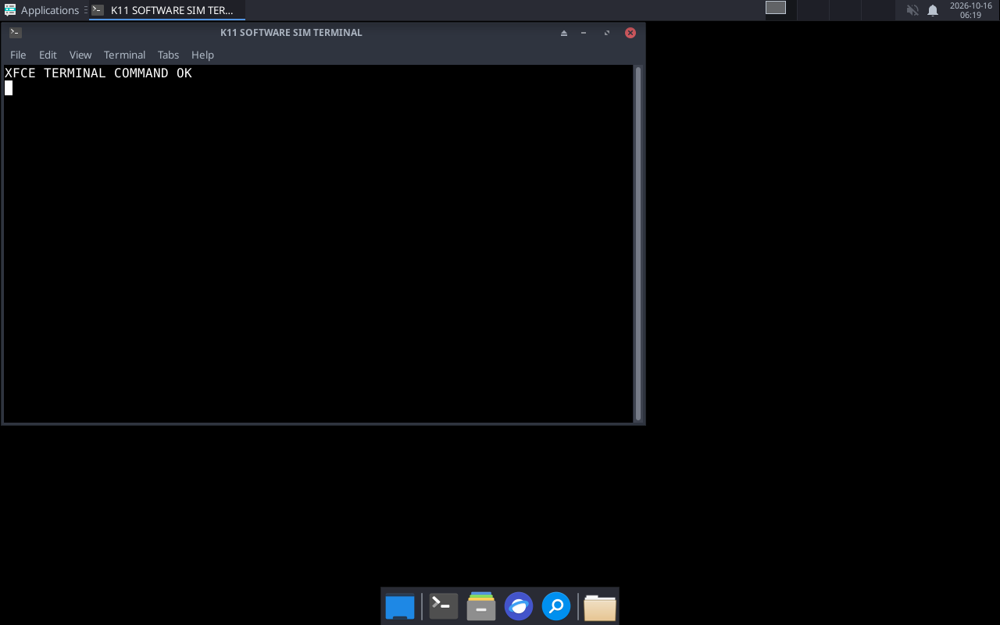

# Termux Linux Setup para Adreno

Instalador para executar um desktop Linux no Android usando **Termux:X11 + Debian/PRoot** e configurar o driver **Turnip K11MCH1** dentro do ambiente glibc.

> **Compatibilidade ainda não certificada em aparelho real.** O instalador e as opções foram testados por simulação; a captura abaixo usa renderização por software (`llvmpipe`), sem GPU Adreno.

## Aparência do desktop



*Captura da simulação: tema Arc-Dark e ícones Papirus aplicados, fundo preto preservado, XFCE e terminal respondendo sob Xvfb/llvmpipe. Não é uma captura de um celular Adreno.*

## O que o instalador configura

- Debian com **glibc** dentro de `proot-distro`.
- Termux:X11 e uma sessão gráfica escolhida no menu.
- Driver **Turnip K11MCH1 v25.1.0-R2**, isolado no Debian/PRoot e validado por SHA-256.
- Launchers para abrir a sessão gráfica e verificar Vulkan e OpenGL/Zink.
- Um pacote de programas Linux: Firefox ESR, VLC, FFmpeg, Audacious, Ristretto (fotos), Git, `wget`, `curl` e Python 3 com Flask.
- Codecs/plugins de mídia via FFmpeg e GStreamer (libav, base, good, bad, ugly e saída PulseAudio).
- Ponte PulseAudio local do Termux para os aplicativos dentro do Debian/PRoot, além de `pavucontrol` e um verificador de áudio.
- Uma demo Flask em `/root/demo_python/app.py`, dentro do Debian, servida na porta 5000 quando iniciada.
- Pacote visual com wallpapers Debian, tema Arc, ícones Papirus, temas específicos para LXQt/MATE/KDE e fontes Noto.

O nome **K11MCH1** identifica o repositório de onde vem o pacote Turnip; não é um componente separado do Android. O aplicativo Winlator **não** é instalado.

## Escolha do desktop

| Opção | Ambiente |
|---:|---|
| 1 | XFCE4 (padrão) |
| 2 | LXQt |
| 3 | MATE |
| 4 | KDE Plasma |

**O Turnip é configurado obrigatoriamente em qualquer opção.** A seleção muda somente os pacotes e o comando que inicia o desktop.

No XFCE, quando ainda não há configuração pessoal, o instalador define **Arc-Dark**, **Papirus-Dark** e fonte Noto Sans. O wallpaper atual não é alterado; os wallpapers Debian ficam disponíveis para seleção manual. Configurações XFCE existentes são preservadas. Nas opções LXQt, MATE e KDE, os respectivos temas são instalados e podem ser selecionados no painel de aparência do desktop.

## Instalação

1. Use o Termux oficial em um Android **AArch64** com GPU Adreno.
2. Instale também o aplicativo Android Termux:X11; ele é necessário para visualizar o desktop.
3. Salve `termux-linux-setup.sh` no Termux e execute:

```bash
bash ~/termux-linux-setup.sh
```

Escolha `1` a `4` quando o menu aparecer. Para execução sem interação, é possível definir a opção antes do comando, por exemplo:

```bash
DESKTOP_CHOICE=1 bash ~/termux-linux-setup.sh
```

O script verifica a arquitetura e a GPU antes de prosseguir. O log fica em `~/termux-linux-setup.log`.

## Abrir e verificar

Depois da instalação, abra o aplicativo Termux:X11 e, no Termux, execute:

```bash
~/start-linux.sh
```

Verificadores disponíveis:

```bash
~/verify-turnip.sh
~/verify-glx.sh
~/verify-audio.sh
```

Para iniciar a demo Flask em outro terminal do Termux:

```bash
proot-distro login debian -- /usr/bin/python3 /root/demo_python/app.py
```

Depois, abra `http://127.0.0.1:5000` no navegador. O teste de `verify-audio.sh` deve ser feito com a sessão gráfica iniciada.

## Avisos importantes

- A release selecionada é **v25.1.0-R2 (2025)**; o repositório de drivers está arquivado. Isso não garante suporte a todo Adreno 6xx, kernel ou firmware.
- O driver requer glibc. Ele é destinado ao Debian/PRoot, não a processos nativos Bionic do Termux.
- O script não instala os antigos pacotes Mesa/Vulkan nativos do Termux e não os remove se já estiverem instalados.
- Os pacotes de ícones, wallpapers, fontes, codecs e aplicativos ocupam espaço adicional; o tema Papirus é especialmente grande. A disponibilidade de codecs depende do formato e dos repositórios Debian habilitados.
- A simulação `llvmpipe` confirma somente a abertura do XFCE e do terminal com renderização por CPU. **Não confirma a inicialização do Turnip/KGSL em Snapdragon/Adreno real.**

## Fontes

- [Script original](https://github.com/orailnoor/termux-linux-setup)
- [Release K11MCH1 Turnip v25.1.0-R2](https://github.com/K11MCH1/WinlatorTurnipDrivers/releases/tag/winlator_v25.1_r2)
- [Documentação Termux:X11](https://github.com/termux/termux-x11)
- [Documentação proot-distro](https://github.com/termux/proot-distro)
- [Wallpapers e artwork Debian (`desktop-base`)](https://packages.debian.org/trixie/desktop-base)
- [Tema Arc (`arc-theme`)](https://packages.debian.org/trixie/arc-theme) e [ícones Papirus](https://packages.debian.org/trixie/papirus-icon-theme)
